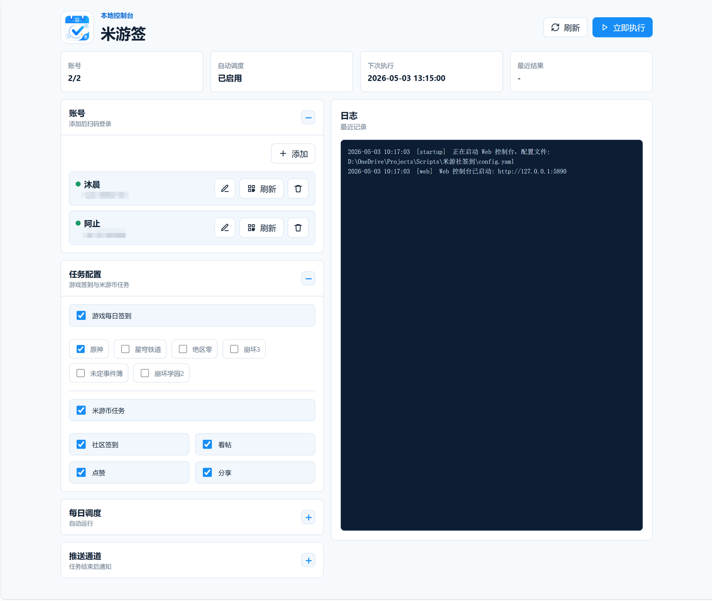

<h1>米游签</h1>

<div align="center">
  <h1 align="center">
    
  </h1>
  <p>一个小而美的带 Web 控制台的米游社签到工具，支持扫码登录、游戏社区签到、云游戏签到、米游币任务、每日自动执行和结果推送。</p>
  <p>
    
    
    
  </p>
</div>

## 简介

米游签是一款小而美，精致便捷的米游社每日签到工具。你只需要用米游社 APP 扫码登录一次，之后就可以在本地 Web 控制台里管理账号、选择任务、设置每天自动执行签到任务。



### 请勿在其他平台宣传本项目，请不要大范围传播本项目！！！

### 大怨种是谁呢

太久没有玩米游了，回坑就做这个项目，要做完突然发现天塌了，米游社要更新米游币获取规则了，部分用户现在已经不能回帖点赞获取米游币了，不知道官方后续的新规是什么，赶上了好时候，卑微QWQ，不知道以后新的规则还能不能搞自动任务

### 交流群
如果你有兴趣参与开发，或者在使用过程中遇到问题，可以加入交流群：

<p align="center">
  
</p>

## 功能

### 最新更新：支持云游戏签到（云原神、云绝区零）！！！
### 最新更新：支持米游社商品兑换功能！！！
### 重大更新：支持自动过验证码！！！

- 米游社 APP 扫码登录
- 多账号管理
- 国际服（HoYoLAB）游戏社区签到
- 游戏社区签到
- 云游戏签到（云原神、云绝区零）
- 米游币社区任务
- 米游社商品兑换
- 本地 Web 控制台
- 每日自动执行
- 执行结果推送
- 日志查看

## 支持的游戏

| 游戏 | 配置名 |
| --- | --- |
| 原神 | `genshin` |
| 崩坏：星穹铁道 | `starrail` |
| 绝区零 | `zzz` |
| 崩坏3 | `honkai3rd` |
| 未定事件簿 | `tears` |
| 崩坏学园2 | `honkai2` |

默认启用原神、崩坏：星穹铁道、绝区零。其他游戏可以在 Web 控制台或配置文件中开启。

## 国际服（HoYoLAB）签到

国际服账号和国服账号放在同一个账号列表、共用同一套任务配置，只在登录方式上不同：

- 国服账号：扫码或验证码登录（同上）
- 国际服账号：在账号卡片里把服务器选为“国际服”，粘贴 HoYoLAB 的 cookie

目前国际服只支持**游戏社区签到**，覆盖原神、崩坏：星穹铁道、绝区零、崩坏3、未定事件簿，开关沿用“游戏社区签到”里勾选的游戏（崩坏学园2 国际服没有签到活动，会自动跳过）。米游币任务、云游戏签到、商品兑换都是国服专属，国际服账号会自动跳过，不需要额外设置。

### 获取 HoYoLAB cookie

1. 用浏览器登录 [HoYoLAB](https://www.hoyolab.com)
2. 按 `F12` 打开开发者工具，进入“应用程序 / Application”（Firefox 是“存储”）-> Cookie -> `https://www.hoyolab.com`
3. 复制 `ltuid_v2` 和 `ltoken_v2` 两项的值，拼成下面的格式，粘贴到登录框里：

```text
ltuid_v2=你的数字ID; ltoken_v2=v2_xxxxxxxx
```

也可以直接整段粘贴请求头里的 `Cookie`。`ltoken_v2` 通常是 HttpOnly，在控制台里用 `document.cookie` 可能读不到，请以 Application 面板为准。

复制之后点登录面板里的「从剪贴板粘贴」就能直接导入，粘贴后会自动显示识别到的 UID 和凭证字段，不用等签到才知道缺了什么。支持的粘贴格式：

- 手拼的 `ltuid_v2=…; ltoken_v2=…`
- 任意请求的整行 `Cookie:` 请求头
- 在 Application → Cookies 表格里框选多行复制（制表符分隔）
- 浏览器扩展导出的 JSON（`[{"name": "ltuid_v2", "value": "…"}]` 或 `{"ltuid_v2": "…"}`）

浏览器不允许读取剪贴板时（比如用局域网 IP 而不是 `127.0.0.1` 访问），按钮会提示手动按 `Ctrl+V`。

点「登录」后会先用一次只读的查询请求确认 cookie 是否有效：无效会直接拒绝并提示重新复制，不会被悄悄存下来；如果当时网络不通，会先保存并在提示里注明“暂时无法在线校验”，签到时会再确认。

### 注意事项

- cookie 和国服凭证一样保存在 `data/credentials.yaml`，不要泄露
- 同一个 UID 可以同时作为国服和国际服账号存在，同一服务器内不能重复
- 国际服接口目前**没有经过真实账号验证**：请求方式参考开源项目 [genshin.py](https://github.com/thesadru/genshin.py)，遇到问题欢迎反馈日志
- 国际服签到触发验证码时只会提示，不会自动过码；这时请到 HoYoLAB 网页或 APP 手动签到一次
- cookie 过期后日志会提示“cookie 已失效，请重新登录”，重新粘贴一次即可。国际服暂不支持自动刷新 cookie

## 云游戏签到

云游戏签到默认关闭，当前支持：

| 云游戏 | 配置名 | 状态 |
| --- | --- | --- |
| 云原神 | `genshin` | 支持 |
| 云绝区零 | `zzz` | 支持 |
| 云星穹铁道 | `starrail` | 不可选，云星穹铁道是版本更新赠送 600 分钟，不需要每日签到获取时长 |

云游戏接口使用 `x-rpc-combo_token`，不是普通米游社 cookie。云游戏 Token 按账号单独配置：先在任务配置里打开总开关，选择要执行的云游戏，再点账号行里扫码登录按钮后面的云游戏图标，填写云原神或云绝区零对应 Token。整体启用后，未选择具体云游戏或未配置对应 Token 的账号会自动跳过。

云游戏 Token 获取方法（参考 MihoyoBBSTools）：

1. 云绝区零无网页版需抓包获取，参考 https://bili33.top/posts/MHYY-AutoCheckin-Manual-Gen2/#%E9%85%8D%E7%BD%AE%E8%8E%B7%E5%8F%96；云原神在浏览器打开[对应云游戏网页](https://ys.mihoyo.com/cloud/#/)并登录账号。
2. 打开开发者工具，切到 `Network` / `网络`。
3. 刷新页面或进入钱包/时长页面，过滤 `wallet/wallet/get`。
4. 点开返回成功的请求，在请求头里复制 `X-Rpc-Combo_token` 的值。
5. 回到米游签账号行，点击云游戏图标，把值填到对应游戏的 Token 输入框。

云原神和云绝区零的 Token 不通用，需要分别复制。这个 Token 属于敏感凭证，存储在 `data/credentials.yaml` 中：

```yaml
# config.yaml - 配置启用哪些云游戏
features:
  cloud_game_checkin: true

cloud_games:
  enabled:
    - genshin
    - zzz

# data/credentials.yaml - 存储 token 凭据
accounts:
  - name: main
    cloud_games:
      tokens:
        genshin: "云原神 x-rpc-combo_token"
        zzz: "云绝区零 x-rpc-combo_token"
```

## 米游社商品兑换

米游社商品兑换功能支持使用米游币自动兑换商品，包括定时兑换和实时兑换两种模式。

### 功能特点

- **商品浏览**：支持按游戏分区浏览可兑换商品列表
- **实时状态**：显示商品库存、兑换时间、限购情况等实时信息
- **定时兑换**：支持设置兑换计划，到点自动兑换
- **重试机制**：支持配置重试时长和间隔，提高兑换成功率
- **多账号支持**：每个账号可配置独立的兑换计划

### 配置说明

在 `config.yaml` 中配置商品兑换功能：

```yaml
shop_exchange:
  enable: true          # 是否启用商品兑换功能
  retry_seconds: 20     # 重试总时长（秒）
  retry_interval: 0.4   # 重试间隔（秒）
  plans: []             # 兑换计划列表
```

### 兑换计划配置

每个兑换计划包含以下字段：

| 字段 | 说明 | 示例 |
| --- | --- | --- |
| `goods_id` | 商品 ID | "12345" |
| `goods_name` | 商品名称（可选，用于显示） | "原神礼包" |
| `account_stuid` | 执行兑换的账号 UID，计划靠它认账号，由 Web 控制台自动填写 | "100000002" |
| `account_index` | 该账号在账号列表中的位置（从 0 开始），由程序根据 `account_stuid` 自动维护 | 0 |
| `address_id` | 收货地址 ID（实物商品必需） | "67890" |
| `uid` | 游戏 UID（游戏内商品必需） | "100000001" |
| `region` | 游戏区服（游戏内商品必需） | "cn_gf01" |
| `game_biz` | 游戏业务标识（游戏内商品必需） | "hk4e_cn" |
| `exchange_at` | 兑换时间戳（秒） | 1700000000 |
| `enable` | 是否启用该计划 | true |
| `auto` | 是否自动执行 | true |
| `device_fp` | 设备指纹（自动获取）。执行时优先用「设备信息」里服务器签发或真机导入的那一枚，这里存的只是创建计划时的备份 | "xxx" |

完整配置示例：

```yaml
shop_exchange:
  enable: true
  retry_seconds: 20
  retry_interval: 0.4
  plans:
    - goods_id: "12345"
      goods_name: "原神礼包"
      account_stuid: "100000002"
      account_index: 0
      address_id: "67890"
      exchange_at: 1700000000
      enable: true
      auto: true
      device_fp: ""
```

计划绑定的是账号的 UID（`account_stuid`），不是账号在列表里的位置。删除或调整账号顺序后，计划会自动跟着原来的账号走；如果绑定的账号已被删除，或同一位置换成了另一个米游社账号，该计划会被停用并提示「所属账号已删除或更换」，不会改用别的账号兑换。需要换账号时请在 Web 控制台重新选择执行账号，手动改配置文件时 `account_stuid` 和 `account_index` 要一起改，只改 `account_index` 会被 `account_stuid` 覆盖。

### 使用方式

#### Web 控制台操作

1. **商品浏览**：在 Web 控制台进入"商品兑换"页面
2. **选择商品**：浏览商品列表，选择要兑换的商品
3. **查看详情**：点击商品查看详细信息，包括库存、兑换时间等
4. **添加计划**：点击"添加兑换计划"，填写相关信息
5. **设置时间**：设置兑换时间（支持定时兑换）
6. **立即兑换**：对于已上架的商品，可以立即兑换

#### 商品类型说明

- **实物商品**：需要填写收货地址
- **游戏内商品**：需要填写游戏 UID、区服信息
- **通用商品**：可能不需要额外信息

### 兑换流程

1. **确认 device_fp**：与其他请求共用「设备信息」里的 device_fp，没有就向官方接口申请；申请不到时会提示，可以改为导入真机的 device_fp（见[设备信息](#设备信息)）
2. **时间校准**：定时兑换前会自动校准服务器时间
3. **精确等待**：兑换前 180 秒进入精确等待模式
4. **重试机制**：在配置的重试时长内持续尝试兑换
5. **结果通知**：兑换完成后通过配置的推送渠道通知

### 注意事项

- 兑换功能需要账号已登录且凭证有效
- 删除账号、更换登录账号后，请检查对应兑换计划的执行账号和游戏角色，被停用的计划需要重新选择账号后再启用
- 早期版本创建的计划没有 `account_stuid`，升级后会绑定到它当前所在位置的账号，请确认执行账号和游戏角色对得上
- 实物商品需要提前在米游社配置收货地址
- 游戏内商品需要确保角色信息正确
- 定时兑换时间建议设置在商品上架时间点
- 重试时长和间隔可根据网络情况调整
- 兑换结果会记录在日志中，失败会显示原因

### 常见问题

**Q: 如何获取商品 ID？**  
A: 在 Web 控制台的商品列表中可以查看所有商品的 ID。

**Q: 如何获取收货地址 ID？**  
A: 在 Web 控制台添加兑换计划时，会自动加载账号的收货地址列表。

**Q: 游戏内商品的 UID 和区服如何填写？**  
A: 在 Web 控制台添加兑换计划时，会自动加载账号的角色信息。

**Q: 兑换失败怎么办？**  
A: 检查日志中的错误信息，常见原因包括：库存不足、时间未到、账号信息错误等。

**Q: 可以同时添加多个兑换计划吗？**  
A: 可以，每个账号可以添加多个兑换计划，系统会按时间顺序执行。

**Q: 删除账号后，兑换计划会怎样？**  
A: 绑定该账号的计划会被停用并显示「账号已删除」，其他账号的计划不受影响，会继续用各自的账号兑换。

## 米游币任务

米游币任务默认关闭，需要时手动开启。可执行的任务包括：

- 社区签到
- 看帖
- 点赞
- 分享
- 点赞后自动取消点赞

米游币任务比游戏社区签到更容易遇到验证码或风控。第一次使用建议先只开启游戏社区签到，确认稳定后再开启米游币任务。

## 部署流程

### Docker 部署（推荐）

适合部署在服务器或 NAS 上，无需手动安装 Python 和 uv。有两种方式：直接拉取预构建镜像（推荐，不需要仓库源码），或者从源码自己构建。

#### 方式一：拉取预构建镜像

镜像由 GitHub Actions 自动构建，发布在 GHCR：`ghcr.io/marchen-orz/miyouqian`，支持 `linux/amd64` 和 `linux/arm64`（普通服务器、NAS、树莓派都可以）。

新建一个目录，把仓库里的 [`docker/docker-compose.image.yml`](docker/docker-compose.image.yml) 保存为 `docker-compose.yml`，然后启动：

```bash
docker compose up -d
```

不想用 compose，也可以一条命令：

```bash
docker run -d --name miyouqian --restart unless-stopped --init \
  -p 5890:5890 -e TZ=Asia/Shanghai \
  -v miyouqian_state:/app/state \
  --read-only --tmpfs /tmp --cap-drop ALL --security-opt no-new-privileges:true \
  ghcr.io/marchen-orz/miyouqian:latest
```

更新到最新镜像：

```bash
docker compose pull && docker compose up -d
```

配置、凭证和日志都在 `miyouqian_state` 卷里，更新镜像不会丢。可用的标签：

| 标签 | 说明 |
| --- | --- |
| `latest` | `master` 分支的最新构建 |
| `0.1.0`、`0.1` | 对应 `v0.1.0` 发布（`0.1` 跟随该小版本的最新补丁） |
| `sha-xxxxxxx` | 某一次提交的构建，需要回退到指定版本时使用 |

启动后访问 `http://localhost:5890`。数据持久化，以及端口、公网访问等注意事项，见下面方式二里的“数据持久化”和“注意事项”，两种方式都适用。

> 之前用方式二（源码构建）部署过、想沿用原来的数据时，把 compose 文件末尾的卷声明改成引用已有的卷：
>
> ```yaml
> volumes:
>   miyouqian_state:
>     external: true
>     name: docker_miyouqian_state
> ```

#### 方式二：从源码构建

想改代码、或者不想用预构建镜像时使用。下面的 1、2 步是构建流程，3、4 步和注意事项两种方式通用。

#### 1. 获取项目文件

```bash
git clone <你的仓库地址>
cd 米游社签到
```

#### 2. 构建并启动

```bash
# 进入 docker 目录
cd docker

# 构建并启动（后台运行）
docker compose up -d --build
```

启动成功后，通过端口映射从宿主机访问 `http://localhost:5890` 即可打开 Web 控制台。

> 容器首次启动时会自动从 `config.example.yaml` 生成 `config.yaml`，无需手动操作。
> 容器内服务已默认监听 `0.0.0.0`（Docker 必需），宿主机通过 `localhost:5890` 访问即可。

#### 3. 常用命令

```bash
cd docker

# 查看日志
docker compose logs -f

# 停止服务
docker compose down

# 重新构建（更新代码后）
docker compose up -d --build
```

#### 4. 数据持久化

`docker-compose.yml` 默认使用 Docker 命名卷保存容器专用数据，不再和项目根目录的 `config.yaml`、`data/`、`logs/` 共用：

| Docker 卷 | 容器路径 | 说明 |
| --- | --- | --- |
| `docker_miyouqian_state`（方式一的 compose 文件里是 `miyouqian_state`） | `/app/state` | Docker 专用配置、登录凭证和运行日志 |

容器重建后数据不会丢失。只有执行 `docker compose down -v` 或手动删除该 Docker 卷时，Docker 环境内的配置和登录凭证才会被删除。

如需查看或备份容器内配置，可以执行：

```bash
docker compose exec miyouqian sh
ls -la /app/state
```

#### 注意事项

- 容器内时区默认为 `Asia/Shanghai`，如需修改可在 `docker-compose.yml` 中调整 `TZ` 环境变量
- 默认映射到宿主机所有网卡的 `5890` 端口，局域网或公网访问还需要在宿主机层面配置防火墙、安全组、端口转发或反向代理
- 如需修改容器内监听端口，同时修改 `docker-compose.yml` 的 `ports` 和 Docker 启动命令中的 `--port`
- 公网访问时请务必设置 Web 控制台密码，首次访问页面会引导设置密码

---

### GitHub Actions 定时签到（无需服务器）

适合不想长期运行电脑、服务器或 NAS 的用户。Actions 会按 `.github/workflows/checkin.yml` 里的时间自动执行一次 `python main.py run`。

> ⚠️ **必须使用 "Use this template" 创建项目，不要使用 Fork！**
>
> Fork 仓库的 Actions 运行时长会统计到上游（原）仓库，会导致上游仓库因超出时长限制而被封禁。
> 请点击仓库右上角的 **`Use this template`** -> **`Create a new repository`**，将项目创建到你自己的 GitHub 账号下。
>
> GitHub Actions 只负责定时触发一次性签到，不会启动 Web 控制台。首次扫码登录和配置调整建议先在本地或 Docker 环境完成。

#### 1. 本地生成配置和凭证

先按“本地部署”或“Docker 部署”完成一次扫码登录，并确认手动执行签到正常。完成后项目目录里会有：

| 文件 | 说明 |
| --- | --- |
| `config.yaml` | 公开配置，不建议直接提交仓库 |
| `data/credentials.yaml` | 登录凭证，敏感信息，绝对不要提交仓库 |

#### 2. 创建项目并启用 Actions

点击本仓库右上角的 `Use this template` -> `Create a new repository`，将项目创建到你自己的 GitHub 账号下。

进入你创建的新仓库后，打开 `Actions` 页面。如果页面提示 workflow 被禁用，点击启用。

开启 Actions 后无论配置 secrets 与否都会每天执行一次。不要在原项目仓库里配置你的账号凭证，也不要把凭证发给项目作者。

#### 3. 添加 GitHub Secrets

进入你创建的仓库：

```text
Settings -> Secrets and variables -> Actions -> New repository secret
```

添加两个 Secret：

| Secret 名称 | 内容 |
| --- | --- |
| `MIYOUQIAN_CONFIG` | 复制 `config.yaml` 的完整内容 |
| `MIYOUQIAN_CREDENTIALS` | 复制 `data/credentials.yaml` 的完整内容 |

粘贴时保留 YAML 原本的换行和缩进。凭证过期、账号变化或推送配置变化后，重新复制最新文件内容覆盖对应 Secret 即可。

#### 4. 修改定时执行时间

默认每天北京时间 `09:20` 执行：

```yaml
schedule:
  - cron: "20 9 * * *"
    timezone: "Asia/Shanghai"
```

如果想改成每天北京时间 `18:30`，改为：

```yaml
schedule:
  - cron: "30 18 * * *"
    timezone: "Asia/Shanghai"
```

`cron` 的 5 个字段分别是：

```text
分钟 小时 日期 月份 星期
```

不建议设置在整点，例如 `0 9 * * *`，整点附近 GitHub Actions 排队更容易延迟。定时任务只会在默认分支上的 workflow 生效。

#### 5. 手动执行一次

进入你创建的仓库的 `Actions` 页面，选择 `米游签定时签到`，点击 `Run workflow`：

`执行模式` 用来决定这一次手动运行要跑哪些任务：

| 选项 | 说明 |
| --- | --- |
| `全部任务` | 默认选项，按 `config.yaml` 中的开关执行游戏社区签到、云游戏签到和米游币社区任务 |
| `只执行游戏社区/云游戏签到` | 只跑游戏社区签到和云游戏签到，跳过米游币社区任务 |
| `只执行米游币社区任务` | 只跑社区签到、看帖、点赞、分享等米游币任务，跳过游戏社区签到和云游戏签到 |

`account` 是可选项，用来只执行某一个账号名；留空则执行 `config.yaml` 中的全部账号。

执行完成后可以在 Actions 日志底部查看任务摘要。如果配置了推送渠道，执行结果也会按 `config.yaml` 中的推送配置发送。

#### 注意事项

- 不要把 `config.yaml`、`data/credentials.yaml`、Actions 日志截图公开给别人
- 不要在原项目仓库提交 Issue、PR 或评论时粘贴任何账号凭证
- GitHub Actions 的定时任务可能会因平台负载延迟几分钟
- 公开仓库如果长期没有活动，GitHub 可能会自动停用定时 workflow
- `config.yaml` 里的 `schedule` 配置不会影响 Actions 定时，Actions 的执行时间以 `.github/workflows/checkin.yml` 为准

---

### 本地部署

下面以本地部署为例。项目推荐使用 `uv` 管理 Python 环境和依赖。Windows 用户可以直接使用 PowerShell；Linux 或 macOS 用户把对应命令换成下方给出的 shell 命令即可。

### 1. 安装 uv

Windows PowerShell：

```powershell
powershell -ExecutionPolicy ByPass -c "irm https://astral.sh/uv/install.ps1 | iex"
```

Linux 或 macOS：

```bash
curl -LsSf https://astral.sh/uv/install.sh | sh
```

安装完成后，重新打开一个终端，检查 uv 是否可用：

```powershell
uv --version
```

看到版本号后再继续下一步。uv 会为项目创建虚拟环境，也可以在需要时自动准备 Python 版本。

### 2. 获取项目文件

如果你下载的是压缩包，请先解压，然后进入解压后的项目目录。

如果你使用 Git，可以执行：

```powershell
git clone <你的仓库地址>
cd 米游社签到
```

后续所有命令都需要在项目目录中执行，也就是能看到 `main.py`、`pyproject.toml` 和 `uv.lock` 的目录。

### 3. 创建虚拟环境并安装依赖

在项目目录执行：

```powershell
uv venv --python 3.11
uv sync
```

这会在项目目录下创建 `.venv`，并安装项目运行所需依赖。日常使用时不需要手动激活虚拟环境，后续命令直接通过 `uv run` 执行即可。

如果下载依赖很慢，可以临时使用镜像源：

```powershell
uv sync --index-url https://pypi.tuna.tsinghua.edu.cn/simple
```

### 4. 启动 Web 控制台

```powershell
uv run python main.py
```

启动成功后，终端会显示访问地址，通常是：

```text
http://127.0.0.1:5890
```

如果端口被占用，程序会自动切换到后续端口。请以终端显示的实际地址为准。

### 5. 完成首次配置

打开 Web 控制台后，按顺序完成：

1. 添加账号
2. 使用米游社 APP 扫码登录
3. 选择要执行的游戏社区签到任务
4. 点击“立即执行”测试一次
5. 测试正常后再开启每日调度和推送

### 6. 保持程序运行

每日自动执行依赖当前程序保持运行。关闭终端、电脑关机或休眠后，自动任务不会继续执行。


---

### 云函数部署
云函数和Github Action类似，但是其在执行任务时使用的是云函数提供商的IP地址，理论上比Github Action更难风控些。缺点是可能会产生非常少量的费用（理论每个月上不到0.1元，实测上月运行了7天产生了0.02元费用被抹零不计费），适合已经用过各种云服务商的用户使用。

### 1.配置项目
参考 [本地部署1-5](#本地部署)

注意：在配置虚拟环境时应使用`uv venv --python 3.10`,因为腾讯云暂时还没有python3.11镜像(如果忘了其实也没关系，因为经过测试3.11安装的依赖在3.10上也能跑，但是最好不要这么做qwq)。
### 2.打包项目
```powershell
uv run python -m pip install -r requirements.txt -t .
```
这一步将会把项目需要的依赖直接安装到项目根目录，安装完成后，将项目压缩为.zip备用

### 3.上传项目并配置自动运行
这里以腾讯云为例（阿里云等其它云服务提供商也有类似服务，方法类似）
#### 3.1 登录并创建云函数
打开 [腾讯云函数](https://console.cloud.tencent.com/scf/list)，登录后依次点击

>新建 > 从头开始 
> 
>函数类型:事件函数
> 
>**运行环境:Python3.10**
> 
>时区:Asia/Shanghai
>
>提交方法：本地上传zip包
> 
>**执行方法：index.main_handler**
>
> 函数代码:上传[第二步](#2打包项目)压缩的压缩包
> 
> 高级设置：
> 
> 初始化超时时间:30
> 
> 执行超时时间:600

勾选同意协议后完成创建
#### 3.2 配置触发器
创建完成后点击你刚刚创建的云函数，选择触发管理>创建触发器
>触发周期：自定义触发周期（推荐）
> 
> Cron表达式:
> 
> 注：这里的Cron表达式和上文中的规则不一样，这里需要7个字段，分别是 
> 
> 秒 分钟 小时 日 月 星期 年
> 
> 示例：
> 
> 每天早上7点30触发：0 30 7 * * * *
> 
> 详细参照[定时触发器说明](https://cloud.tencent.com/document/product/583/9708)

---

## 快速开始

推荐使用 Web 控制台完成所有日常操作。

### 1. 启动

在项目目录运行：

```powershell
uv run python main.py
```

启动成功后，终端会显示 Web 控制台地址，通常是：

```text
http://127.0.0.1:5890
```

如果 `5890` 端口被占用，程序会自动尝试后续端口。请以终端里显示的实际地址为准。

### 2. 添加账号

打开 Web 控制台后：

1. 在“账号”区域点击“添加”
2. 可以先把账号名改成 `main`、`小号1` 等方便识别的名字
3. 点击“保存”，账号就会出现在列表里（此时还没登录）
4. 点击账号卡片里的“登录方式”，选扫码或验证码登录

扫码路径：

```text
米游社 APP -> 我的 -> 左上角扫一扫
```

登录成功后，账号卡片会显示 UID。

国际服账号：在第 2 步把服务器改成“国际服”，保存后点账号卡片里的“粘贴 Cookie”，详见上方“国际服（HoYoLAB）签到”。

### 3. 选择任务

在“任务配置”里选择你想执行的内容：

- 游戏社区签到
- 具体游戏
- 云游戏签到
- 米游币任务
- 社区签到、看帖、点赞、分享

第一次使用建议只开启“游戏社区签到”，先跑通一次。

### 4. 手动测试

点击右上角“立即执行”。执行过程中可以在右侧日志区域查看结果。

如果提示“今日已签到”，说明账号和任务配置已经正常。

### 5. 开启每日自动执行

确认手动执行正常后，再展开“每日调度”：

1. 勾选“启用每日自动执行”
2. 设置执行时间
3. 设置随机波动分钟
4. 按需选择“程序启动时立即执行一次”（仅在程序启动时生效，与每日自动执行无关）

示例：执行时间为 `09:00`，随机波动为 `45`，表示每天 09:00 到 09:45 之间随机执行一次。

自动执行要求程序保持运行。关闭终端、电脑关机或休眠后，任务不会继续执行，所以推荐服务器上运行。

## Web 控制台说明

Web 控制台主要分为几块：

| 区域 | 用途 |
| --- | --- |
| 顶部状态 | 查看账号数量、自动调度状态、下次执行时间、最近结果 |
| 账号 | 添加账号、扫码登录、刷新凭证、删除账号 |
| 任务配置 | 开关游戏社区签到、云游戏签到和米游币任务 |
| 每日调度 | 设置每天什么时候自动运行 |
| 推送通道 | 设置任务完成后的通知方式 |
| 设备信息 | 查看 device_id / device_fp，向服务器申请 fp，导入真机信息，换一台虚拟设备 |
| 日志 | 查看本次启动后的运行记录 |

日志区域只显示本次 Web 服务启动后的记录。历史日志会保存在 `logs/miyouqian.log`。

## 命令行用法

如果你不想使用 Web 控制台，也可以用命令行。

生成配置：

```powershell
uv run python main.py init
```

扫码登录：

```powershell
uv run python main.py login --account main
```

执行全部任务：

```powershell
uv run python main.py run
```

只执行指定账号：

```powershell
uv run python main.py run --account main
```

只执行游戏社区签到和云游戏签到：

```powershell
uv run python main.py run --games-only
```

只执行米游币任务：

```powershell
uv run python main.py run --bbs-only
```

只执行指定游戏：

```powershell
uv run python main.py run --game genshin --game starrail
```

启动 Web 控制台并指定端口：

```powershell
uv run python main.py serve --port 5891
```

`--host` 和 `--port` 参数会覆盖配置文件中的设置。不指定时读取 `config.yaml` 中的 `web.host` 和 `web.port`。

查看当前配置摘要：

```powershell
uv run python main.py show
```

## 常用设置

大多数设置都可以在 Web 控制台里完成。只有在需要批量修改、迁移配置或高级调整时，才建议手动编辑 `config.yaml`。

请使用 UTF-8 编码保存配置文件，否则中文可能乱码。

### 文件位置

默认会生成或使用这些文件：

```text
config.yaml              # 账号名称、任务开关、调度、推送等普通配置
data/credentials.yaml    # 登录凭证
logs/miyouqian.log       # 历史日志
qrcode.png               # 命令行扫码登录时生成的二维码图片
```

开发时不要把这些文件上传到公开仓库，尤其是 `data/credentials.yaml`。

### 账号

Web 控制台添加账号后，会在配置中保存账号名。扫码登录成功后，登录凭证会单独保存到 `data/credentials.yaml`。

通常不需要手动填写 cookie 或 stoken。

每个账号有一个 `region` 字段：`cn`（国服，默认，旧配置无需修改）或 `os`（国际服）。它不是敏感信息，保存在 `config.yaml`；国际服账号的 cookie 和国服一样存放在 `data/credentials.yaml`，`stoken`、`mid` 为空。

```yaml
accounts:
  - name: main
    region: cn
  - name: hoyolab
    region: os
```

### 游戏社区签到

如果你想手动指定游戏，可以编辑：

```yaml
games:
  enabled:
    - genshin
    - starrail
    - zzz
```

如果某个游戏里有多个角色，但你想跳过其中一个角色，可以把角色 UID 加到黑名单：

```yaml
games:
  black_list:
    genshin:
      - "100000001"
```

### 云游戏签到

开启云游戏签到：

```yaml
features:
  cloud_game_checkin: true
```

选择要执行的云游戏：

```yaml
cloud_games:
  enabled:
    - genshin
    - zzz
```

在 `data/credentials.yaml` 中为每个账号填写云游戏 Token：

```yaml
accounts:
  - name: main
    cloud_games:
      tokens:
        genshin: "云原神 x-rpc-combo_token"
        zzz: ""
```

云游戏 Token 获取方法：

1. 云绝区零无网页版需抓包获取，参考 https://bili33.top/posts/MHYY-AutoCheckin-Manual-Gen2/#%E9%85%8D%E7%BD%AE%E8%8E%B7%E5%8F%96；云原神在浏览器打开[对应云游戏网页](https://ys.mihoyo.com/cloud/#/)并登录账号。
2. 打开开发者工具，切到 `Network` / `网络`。
3. 刷新页面或进入钱包/时长页面，过滤 `wallet/wallet/get`。
4. 点开返回成功的请求，在请求头里复制 `X-Rpc-Combo_token` 的值。
5. 回到米游签账号行，点击云游戏图标，把值填到对应游戏的 Token 输入框。

云原神和云绝区零的 Token 不通用，需要分别复制。云星穹铁道会在 Web 控制台中显示为不可选状态，原因是云星穹铁道是版本更新赠送 600 分钟，不需要每日签到获取时长。未选择具体云游戏或未配置对应 Token 的账号会在整体启用后跳过。

### 米游币任务

开启米游币任务：

```yaml
features:
  bbs_tasks: true
```

常用选项：

```yaml
bbs:
  forums:
    - 5
    - 2
  checkin: true
  read: true
  like: true
  share: true
  cancel_like: true
  delay_seconds:
    - 1
    - 3
```

社区 ID：

| ID | 社区 |
| --- | --- |
| `1` | 崩坏3 |
| `2` | 原神 |
| `3` | 崩坏2 |
| `4` | 未定事件簿 |
| `5` | 大别野 |
| `6` | 崩坏：星穹铁道 |
| `8` | 绝区零 |
| `9` | 崩坏：因缘精灵 |

### 设备信息

请求米游社接口时会带上一份设备信息：`x-rpc-device_id`、`x-rpc-device_fp`、机型、系统版本和 WebView UA。它们都来自同一份设备档案（`config.yaml` 的 `device`），彼此保持一致：

- **device_id**：首次运行时本地生成并长期保存。
- **device_fp**：向官方 `getFp` 接口申请，签发成功才保存，并标注来源。申请失败时（接口偶尔返回「内部错误」）会重试几次，仍失败就**不带** `x-rpc-device_fp`，不会再用随机串顶替；失败后 60 秒内不重复申请。
- **机型**：默认取自内置的几款机型预设（品牌、型号、系统版本、SoC 互相对得上）；导入真机信息后以真机为准。
- 项目**不会**伪造传感器、电量这类遥测数据；只有你导入的真机 `ext_fields` 才会原样带上。

Web 控制台的「设备信息」面板可以：

| 操作 | 说明 |
| --- | --- |
| 向服务器申请 fp | 立即重新申请一枚 device_fp，成功后覆盖旧的 |
| 导入真机信息 | 粘贴从自己手机抓到的内容，设备 ID、fp、机型、系统版本、UA 都会改用真机的 |
| 换一台虚拟设备 | 选一个预设机型（或随机），生成新的 device_id，旧 fp 作废并重新申请；账号凭证不受影响 |

使用真机信息比预设更接近 App 的真实请求，但风控并不只看设备信息，不能保证不再出现验证码。导入后本工具与那台手机上的米游社 App 会共用同一个设备标识。

#### 抓取真机信息

在自己的 Android 手机上用抓包工具（Reqable、HttpCanary、mitmproxy、Charles 等）抓米游社 App 的 HTTPS 请求。Android 7 以上的 App 默认不信任用户证书，米游社通常需要把抓包工具的证书装成系统证书（root，或 Magisk 的证书移动模块）才能解密。

抓到请求后，以下任意一种内容都可以粘贴到「导入真机信息」里：

- **任意一个 `bbs-api.miyoushe.com` 请求的请求头**（在 App 里点一下签到或刷新首页即可），包含 `x-rpc-device_id`、`x-rpc-device_fp`、`x-rpc-device_name`、`x-rpc-device_model`、`x-rpc-sys_version` 和 `User-Agent`。直接复制整段请求头，或用「Copy as cURL」都行。
- **`public-data-api.mihoyo.com/device-fp/api/getFp` 的请求体 / 响应 JSON**（App 冷启动或重装后可能发出，抓不到就用上一种方式）：请求体会带出 Android ID、oaid、`ext_fields` 里的整套机型信息；响应里的 `data.device_fp` 是服务器签发的 fp。请求体里的 `device_fp` 只是种子，响应 `code` 不是 200 时的 `device_fp` 也只是回显的种子，这两种都不会被当成 fp 导入。
- 含 `device_id`、`device_fp`、`device_model` 等字段的 JSON，或 `device_id=...` 这样的键值。

没有识别到任何设备信息时会提示，不会改动现有档案。更换 `device_id` 时，旧设备的 fp、oaid、UA 等会一并清除，避免新旧设备信息混在一起。

### 验证码识别

项目默认不会自动处理验证码。验证码识别按渠道配置，目前支持打码狗和自定义接口；同一时间只会使用一个渠道，Web 控制台中勾选其中一个会自动取消另一个。

```yaml
captcha:
  max_retries: 3
  channels:
    - provider: damagou
      enable: false
      userkey: ""
      timeout: 60
    - provider: custom
      enable: false
      url: ""
      api_key: ""
      timeout: 120
```

说明：

| 设置 | 说明 |
| --- | --- |
| `max_retries` | 每次触发验证码后最多重新获取并识别的次数 |
| `channels[].provider` | 打码渠道，目前支持 `damagou`、`custom` |
| `channels[].enable` | 是否启用该渠道 |
| `channels[].userkey` | 打码狗用户 `userkey`（仅 `damagou`） |
| `channels[].url` | 自定义接口的完整地址，按填写内容原样请求，路径不限（仅 `custom`） |
| `channels[].api_key` | 自定义接口的 API Key，选填；填写后通过请求头 `X-API-Key` 发送，留空则不发送（仅 `custom`） |
| `channels[].timeout` | 调用打码接口的超时时间，单位秒；`damagou` 默认 60，`custom` 默认 120 |

打码狗的 `type` 默认不需要设置；识别困难时可以在配置文件中给该渠道补 `type: "1006"`，会增加积分消耗。

#### 自定义接口

选择「自定义接口」后，项目会按固定规范调用你填写的打码服务：`GET {url}?gt=...&challenge=...`，按需通过请求头 `X-API-Key` 鉴权，响应为统一的 `code` / `message` / `request_id` / `data` 信封，`code = 0` 时取 `data.validate` 作为识别结果。完整的请求、响应与错误码规范见 [`miyouqian/webui/custom-captcha-api.md`](miyouqian/webui/custom-captcha-api.md)；在 Web 控制台选中「自定义接口」后，也可以点击「查看规范」在页面内阅读，或点击「复制规范」一键复制全文。

调用时的处理方式：

- `42901`（频率限制）、`50301` / `50302`（服务繁忙或排队超时）：按响应头 `Retry-After` 等待后用同一个验证码重试（服务端此时还没开始识别），等待超过 60 秒则不再等待；单次识别最多请求 3 次。
- 其余非 `0` 的 `code`（包括 `50001` / `50000`）一律视为失败，不会在接口层重试：极验的验证码用过一次就作废，原样重发只会被秒拒。失败信息会带上 `code` 和 `request_id`（如有）写入日志，随后由下方的「重新获取验证码」流程处理。
- `url` 按填写的完整地址原样请求，不会自动追加路径。`api_key` 会在配置变更日志中脱敏，请勿提交到公开仓库。

识别、校验或提交失败时，会重新获取验证码并重试，最多执行 `max_retries` 次。
如果打码狗识别接口返回错误且错误信息包含“余额”，任务会按失败状态通过已配置的推送渠道发送“打码狗余额不足”通知。

### 每日调度

```yaml
schedule:
  enable: true
  time: "09:00"
  jitter_minutes: 45
  run_on_start: false
```

含义：

| 设置 | 说明 |
| --- | --- |
| `enable` | 是否开启每日自动执行 |
| `time` | 每天的基准执行时间 |
| `jitter_minutes` | 随机延后分钟数 |
| `run_on_start` | 启动 Web 服务后是否立即执行一次 |

### 网络访问与密码

Web 控制台默认只监听本机地址 `127.0.0.1`，只能在本机浏览器中访问。

如果需要从局域网或外网访问（例如部署在服务器上），可以在配置文件中修改监听地址：

```yaml
web:
  host: "0.0.0.0"   # 监听地址，设为 0.0.0.0 允许外部访问
  port: 5890        # 监听端口
  password: ""      # 访问密码（见下方说明）
```

**密码说明：**

- 实际启动时的监听地址决定认证模式；命令行 `--host` 会覆盖配置文件中的 `web.host`
- 监听 `127.0.0.1`、`localhost` 或 `::1` 时，密码设置完成后无需登录，直接访问即可
- 监听 `0.0.0.0` 或其他非本机地址时，必须通过密码认证才能使用
- 密码为空时，首次访问会显示密码设置页面；密码至少需要 8 位，设置后自动保存（存储为哈希值）
- 也可以在配置文件中直接填写明文密码，启动时会自动转换为哈希
- 服务重启后需要重新输入密码

| 设置 | 说明 |
| --- | --- |
| `host` | 监听地址，`127.0.0.1` 仅本机，`0.0.0.0` 允许外部 |
| `port` | 监听端口，默认 `5890` |
| `password` | 访问密码，留空首次通过页面设置，也可直接填写明文 |

## 推送设置

推送可以在 Web 控制台中配置。开启后，任务结束时会发送结果通知。

如果只想失败时通知，勾选“仅失败时推送”，或设置：

```yaml
push:
  error_only: true
```

### pushplus

需要填写：

- Token
- 群组编码，可留空

示例：

```yaml
push:
  channels:
    - provider: pushplus
      enable: true
      token: "你的 token"
      topic: ""
```

### Server酱³

注意：**Server酱³ 与 Server酱Turbo 是两套用户体系，SendKey 不通用**。本项目接的是 Server酱³（[sc3.ft07.com](https://sc3.ft07.com/)）。

需要填写：

- **SendKey**：在 [SendKey 页面](https://sc3.ft07.com/sendkey) 获取，形如 `sctp1234tXXXXXXXXXXXXXXXX`
- **UID**：**可以留空**。官方文档写明 uid 就在 SendKey 的 `sctp{uid}t` 前缀里，本项目会自动解析；只有解析不出来时才需要手填

示例：

```yaml
push:
  channels:
    - provider: serverchan
      enable: true
      sendkey: "sctp1234tXXXXXXXXXXXXXXXX"
      uid: ""
```

推送地址为 `https://<uid>.push.ft07.com/send/<sendkey>.send`，用 `POST` + JSON 提交（`{"title": ..., "desp": ...}`，正文为 markdown，APP 内可渲染）。这样中文和换行都不需要手工 `urlencode`，也不会撞上 URL 长度限制。

如果 HTTP 返回 200 但 `code` 不为 `0`（例如 SendKey 失效），控制台的「推送测试」会直接把这个错误信息显示出来。

### Telegram

需要填写：

- Bot Token
- Chat ID
- 自定义 API URL ，可留空

示例：

```yaml
push:
  channels:
    - provider: telegram
      enable: true
      token: "bot token"
      chat_id: "chat id"
      api_url: ""
```

### QQ 机器人（QQ 开放平台官方 Bot）

> 这一项和上面的 `provider: qq` 完全无关。`qq` 走的是第三方 OneBot 框架的 HTTP API（需要自己搭 `push_url`），这里走的是 QQ 开放平台官方 OpenAPI，只需要 AppID 和 AppSecret。

需要填写：

- **AppID**：在 [QQ 开放平台](https://bot.q.qq.com/open) 机器人管理端获取
- **AppSecret**：同上，注意不要泄露，配置文件里请勿提交到公开仓库
- **私聊 OpenID / 群 OpenID**：可以**手动填写**；也可以点 Web 控制台里的「绑定私聊」/「绑定群聊」按钮自动获取并保存（见下方说明）
- **消息格式**：纯文本或 Markdown，默认纯文本
- **接口地址**：可留空，默认 `https://api.bot.qq.com`；使用沙箱环境时填 `https://sandbox.api.sgroup.qq.com`

示例：

```yaml
push:
  channels:
    - provider: qqbot
      enable: true
      app_id: "102000000"
      client_secret: "你的 AppSecret"
      user_openid: ""        # 手动填写，或用「绑定私聊」按钮自动填入
      group_openid: ""       # 手动填写，或用「绑定群聊」按钮自动填入
      message_format: text   # text 或 markdown
      api_base: ""           # 可留空
```

#### 自动绑定（可选）

QQ 官方接口发送消息要把 `user_openid` / `group_openid` 填进 URL，这两个 ID 是**每个机器人不同**的，而且开放平台**没有提供查询接口**，只能在机器人收到消息或入群事件时被动拿到。如果你手上已经有这两个 ID，直接填进配置即可；没有的话可以用绑定按钮自动获取：

1. 在「推送通道 - QQ 机器人」里填好 AppID 和 AppSecret，勾选启用
2. 点「绑定私聊」：页面显示一个 6 位验证码，用 QQ 私聊机器人把这个验证码发出去，程序收到后自动把 `user_openid` 写进配置**并立即保存**
3. 点「绑定群聊」：把机器人拉进群，或在群里 @机器人 发送页面上的验证码，同样会自动保存 `group_openid`

两种情况都要在 90 秒内完成，超时后重新点一次即可。绑定过程中配置字段会暂时锁定（避免与自动保存冲突），绑定按钮旁边可以随时取消。绑定成功后页面会重新读取配置，显示的就是磁盘上保存的内容。

#### 注意事项

- **主动推送有限制**：QQ 官方对机器人的主动消息（用户没先说话就推送）有额度和频率限制，群聊还要求机器人在群里、并可能需要先申请主动消息权限。如果推送报错，先在 QQ 开放平台确认权限，或用「测试推送」单独排查这一条通道。
- 私聊和群聊都配置时，两边都会发；只有一边发失败不会影响另一边，但失败原因会写进推送结果和日志。
- 事件权限要在开放平台申请：私聊需要单聊事件权限，群聊需要群聊事件权限，没开通时绑定时会直接报错提示。
- `access_token` 有效期 7200 秒，程序会自动缓存和刷新，不需要手动维护。

### 钉钉机器人

需要填写：

- Webhook
- 加签 Secret，可留空

示例：

```yaml
push:
  channels:
    - provider: dingrobot
      enable: true
      webhook: "https://oapi.dingtalk.com/robot/send?access_token=..."
      secret: "SEC..."
```

### 飞书机器人

需要填写：

- Webhook
- 加签 Secret，可留空

示例：

```yaml
push:
  channels:
    - provider: feishubot
      enable: true
      webhook: "https://open.feishu.cn/open-apis/bot/v2/hook/..."
      secret: "SEC..."
```

### 企业微信机器人

需要填写：

- Webhook

可选开启页面中的「纯文本消息（兼容微信）」，对应 `plain_text: true`。开启后，签到及兑换通知使用普通文本，适用于微信端提示「暂不支持此消息类型」的情况；关闭或不配置时保持原有 Markdown 格式。普通文本最多 2048 个 UTF-8 字节，Markdown 最多 4096 个 UTF-8 字节，超长内容会优先按完整行自动分成多条、依次发送，单行过长时按 UTF-8 字符边界切分，保留完整内容。

同一进程内，同一个机器人的发送间隔至少 3.1 秒，签到、兑换和网页测试共用节流；其他应用共用机器人时仍需注意总频率。发送中途失败会停止后续分条，并在推送结果中注明已成功发送的条数；不会自动重发，以免重复通知。

示例：

```yaml
push:
  channels:
    - provider: wecombot
      enable: true
      webhook: "https://qyapi.weixin.qq.com/cgi-bin/webhook/send?key=..."
      plain_text: false  # 默认 Markdown；改为 true 使用普通文本
```

### 邮箱

需要填写：

- SMTP 服务器
- SMTP 端口
- 邮箱账号
- 邮箱授权码
- 发件人
- 收件人

示例：

```yaml
push:
  channels:
    - provider: email
      enable: true
      smtp_host: "smtp.example.com"
      smtp_port: 465
      smtp_user: "name@example.com"
      smtp_password: "邮箱授权码"
      mail_from: "name@example.com"
      mail_to: "target@example.com"
      smtp_ssl: true
```

多个收件人通常可以用英文逗号分隔。

### Gotify

需要填写：

- 服务器地址（Gotify 服务的访问地址，不含 `/message` 路径）
- App Token（在 Gotify 后台创建应用后获得）

示例：

```yaml
push:
  channels:
    - provider: gotify
      enable: true
      server: "https://gotify.example.com"
      token: "你的 App Token"
      priority: 5   # 优先级 0-10，可选，默认 5
```

消息正文使用 Markdown 格式，Gotify 原生支持。

注意：

- 服务器地址的 `http` / `https` 要和实际访问方式一致。程序不会跟随重定向，如果你的反向代理会把 `http` 跳转到 `https`，推送会报“服务器返回了重定向”，把地址改成 `https://...` 即可。
- 优先级超出 0-10 会按边界处理，留空或填了非数字则使用默认值 5。

## 推荐使用流程

第一次使用建议这样做：

1. 安装 uv
2. 创建虚拟环境并安装依赖
3. 运行 `uv run python main.py`
4. 打开 Web 控制台
5. 添加账号并扫码登录
6. 只开启游戏社区签到
7. 点击“立即执行”
8. 确认日志正常
9. 开启每日调度
10. 按需开启推送
11. 最后再考虑开启米游币任务

## FAQ

### 扫码登录后凭证保存在哪里？

默认保存在 `data/credentials.yaml`。普通设置保存在 `config.yaml`。

### 为什么 `config.yaml` 里看不到 cookie？

登录凭证会单独保存，避免普通配置文件里直接暴露敏感信息。

### Web 控制台打不开怎么办？

先看终端里显示的实际地址。默认端口是 `5890`，可以在配置文件 `web.port` 中修改，如果被占用，程序会自动切换到后续端口。

也可以手动指定端口：

```powershell
uv run python main.py serve --port 5891
```

### 自动调度没有执行？

请检查：

- 程序是否一直运行
- “每日调度”是否已开启
- 电脑是否休眠或关机
- 当前时间是否已经过了今天的执行窗口
- 日志里是否显示了下次执行时间

### 签到提示首次绑定怎么办？

部分游戏第一次绑定签到活动时，需要先在米游社或活动页面手动签到一次。手动完成后，后续再交给米游签执行。

### 遇到验证码怎么办？

默认不会自动处理验证码。遇到验证码时会跳过该项并写入日志。可以稍后手动签到，或降低米游币任务使用频率。

如果你有打码狗 `userkey` 或符合规范的自定义打码接口，可以在 Web 控制台开启验证码识别。项目只负责调用打码渠道并按游戏社区签到、米游币社区签到两种不同方式提交结果。

### 米游币任务失败，但游戏社区签到正常？

这是可能的。米游币任务更容易受到验证码、风控和任务状态影响。建议先确保游戏社区签到稳定，再开启米游币任务。

可以在 Web 控制台「设备信息」里确认 device_fp 是否来自服务器或真机导入；如果显示「未获取」或「来源不明」，可以点「向服务器申请 fp」，或[导入真机信息](#设备信息)。

### 可以添加多个账号吗？

可以。每个国服账号都需要分别扫码登录，国际服账号需要分别粘贴 HoYoLAB cookie。不要在同一个服务器里重复添加同一个 UID。

### 可以放到服务器运行吗？

本项目推荐放到服务器运行，但要注意：

- 扫码登录时需要能看到二维码
- 如果需要外部访问，将 `web.host` 设为 `0.0.0.0`，并设置访问密码
- 也可以用 `--host 0.0.0.0` 启动，但密码仍需在配置文件或首次访问时设置
- 服务器时间会影响每日调度时间

## 下一步计划

| 完成 | 计划 | 完成时间 |
| --- | --- | --- |
| [ ] | 补充更多游戏渠道签到 | -- |
| [x] | 新增米游社其他功能，例如米游币兑换功能 | 2025-01 |
| [ ] | 补充更多推送渠道（已新增 QQ 开放平台官方机器人渠道） | -- |
| [ ] | 优化签到流程，降低风控风险 | -- |
| [ ] | 增加配置导入、导出功能 | -- |
| [ ] | 完善产品文档 | -- |
| [ ] | 持续适配米游社规则变化，尽量保持工具可用 | -- |
| [ ] | ... | -- |

## 注意事项

- 请妥善保管 `data/credentials.yaml`
- 不要公开上传配置文件、日志文件或二维码图片
- 遇到验证码时需要手动处理
- 如果米游社规则变化，可能会出现签到失败，需要等待项目更新
- 使用自动化工具存在账号风控风险，请低频、保守使用

## 致谢

本项目的部分功能思路参考：

- [Womsxd/MihoyoBBSTools](https://github.com/Womsxd/MihoyoBBSTools)
- [jiarui666/mihoyo_qr_login](https://github.com/jiarui666/mihoyo_qr_login)

## Star History

<a href="https://www.star-history.com/?repos=marchen-orz%2FMiyoQian&type=date&legend=top-left">
 <picture>
   <source media="(prefers-color-scheme: dark)" srcset="https://api.star-history.com/chart?repos=marchen-orz/MiyoQian&type=date&theme=dark&legend=top-left&sealed_token=vhjwsuuACDb_LXawTSesqGkBuPYIJlyRBfjCPheEATOVtk6XKQgfA354iSfjKh8YZ4QCdB3axWHYABMpO0J401QGujQHvpHahsp6thneSwwrO-KLnOefX-uozkYik3m7fNZK3QSjokXuwKwg2V8dBT9puj0uGGplCs-ydFHzG8Mrx7YBoGYhfMUtKUYU" />
   <source media="(prefers-color-scheme: light)" srcset="https://api.star-history.com/chart?repos=marchen-orz/MiyoQian&type=date&legend=top-left&sealed_token=vhjwsuuACDb_LXawTSesqGkBuPYIJlyRBfjCPheEATOVtk6XKQgfA354iSfjKh8YZ4QCdB3axWHYABMpO0J401QGujQHvpHahsp6thneSwwrO-KLnOefX-uozkYik3m7fNZK3QSjokXuwKwg2V8dBT9puj0uGGplCs-ydFHzG8Mrx7YBoGYhfMUtKUYU" />
   
 </picture>
</a>

## 免责声明

本项目仅供学习和个人使用，请勿用于商业用途或违反米哈游、米游社相关用户协议的场景。

使用本项目产生的账号风险、数据丢失、任务失败、风控限制或其他后果均由使用者自行承担。请妥善保管账号凭证，不要将配置文件、日志文件或二维码图片公开分享。

如果你不同意以上内容，请不要使用本项目。

## 友链

- [linux.do](https://linux.do/) 学AI来L站~
